# Fissura — POC jogável

Coleta por toque + automação + defesa + merge, num mapa pequeno com névoa de
guerra. Pixel art própria, pensada para celular em pé. Rode e abra no celular
(ou no navegador com a janela estreita):

```sh
npm install
npm run dev      # http://localhost:5173 — no celular, use o IP da máquina
```

## Como testar o ciclo completo (3 a 5 minutos)

1. **Coleta manual.** Toque várias vezes numa árvore (8 toques → 4 biomassa)
   ou numa pedra (10 toques → 4 minério). A barrinha embaixo do elemento mostra
   quanto falta; ao cair, um `+4` flutua e o contador no topo sobe.
2. **Automação.** Com 6 biomassa + 4 minério, toque em **Coletor**. Um robô
   sai do núcleo e passa a bater sozinho no elemento mais próximo. Seus toques
   continuam valendo (aceleram). **Brocas x2** (8 minério) dobra a força de
   cada golpe, seu e dos coletores.
3. **Exploração.** As placas `?` encostadas na névoa custam 4 biomassa. Toque
   numa: a sonda voa até lá e a área aparece em ~7 s (o bosque ao norte tem
   muita biomassa; a pedreira a oeste, muito minério).
4. **Defesa.** Comprar o coletor liga o relógio: a primeira horda avisa aos
   45 s ("Tremor!", a tela treme, a fissura a leste se revela) e chega aos
   60 s. Toque em **Torreta**, depois num tile marcado para posicionar.
5. **Merge.** Toque numa torreta e depois em outra do mesmo nível: viram uma
   de nível maior (dano 1 → 3 → 8). As candidatas piscam em amarelo.
6. **Horda.** Larvas saem da fissura e rastejam até o núcleo, mordendo o que
   encontram. Tocar nelas também machuca. Seta vermelha na borda da tela
   aponta a ameaça fora do enquadramento.
7. **Fim.** Sobreviver às 3 hordas = _Colônia estabilizada_. Núcleo a 0 =
   _O núcleo caiu_. "Jogar de novo" recomeça com outra semente.

Arraste para mover a câmera (dedo ou mouse). Toque e arrasto não conflitam:
mover mais de 8 px vira arrasto e não dispara toque ao soltar.

## Capturas (iPhone 13, Playwright, toques reais)

| Estado                                                   | Captura                                                     |
| -------------------------------------------------------- | ----------------------------------------------------------- |
| Início: 5 toques na árvore, barrinha de desgaste         | 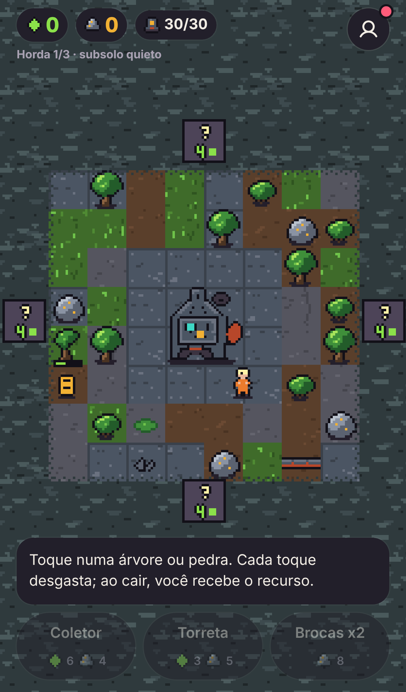                                      |
| Automação: coletor batendo numa pedra sozinho            | 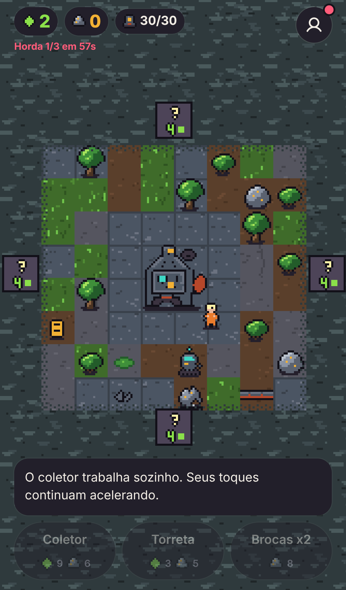                                   |
| Exploração: sonda a caminho / bosque revelado            | 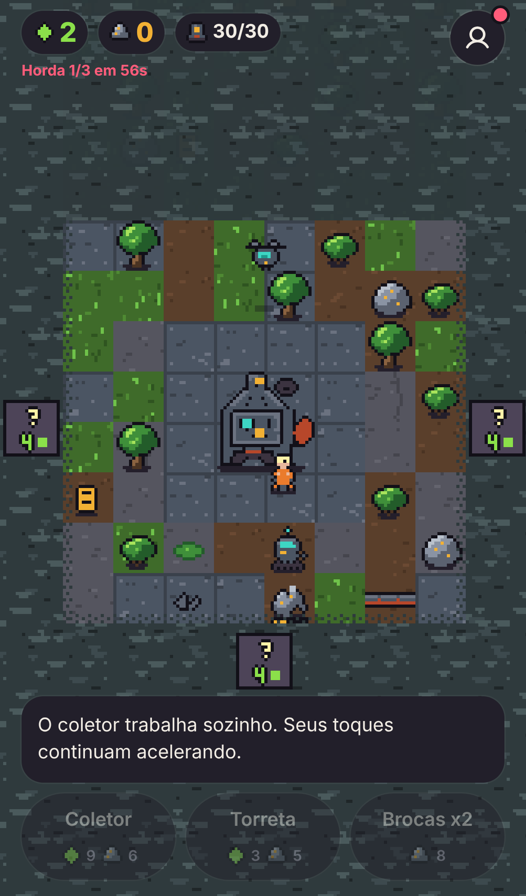 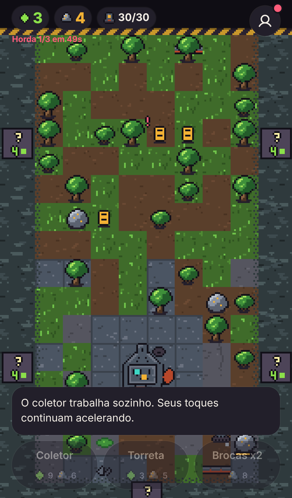 |
| Posicionar torreta (tiles válidos marcados)              | 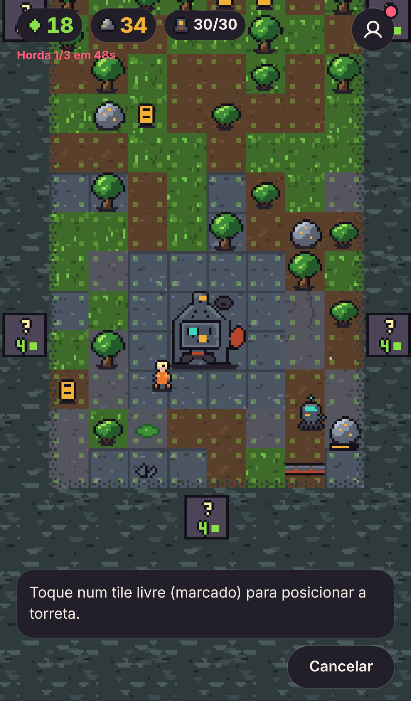                                  |
| Merge: seleção com alcance e candidatas / resultado Nv.2 | 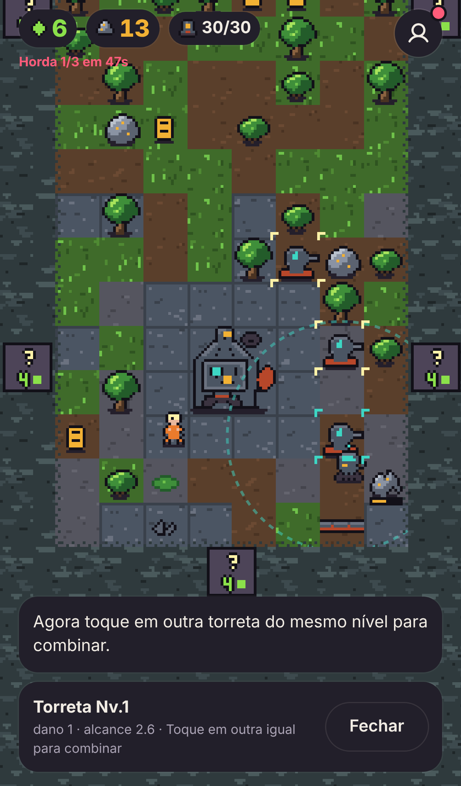 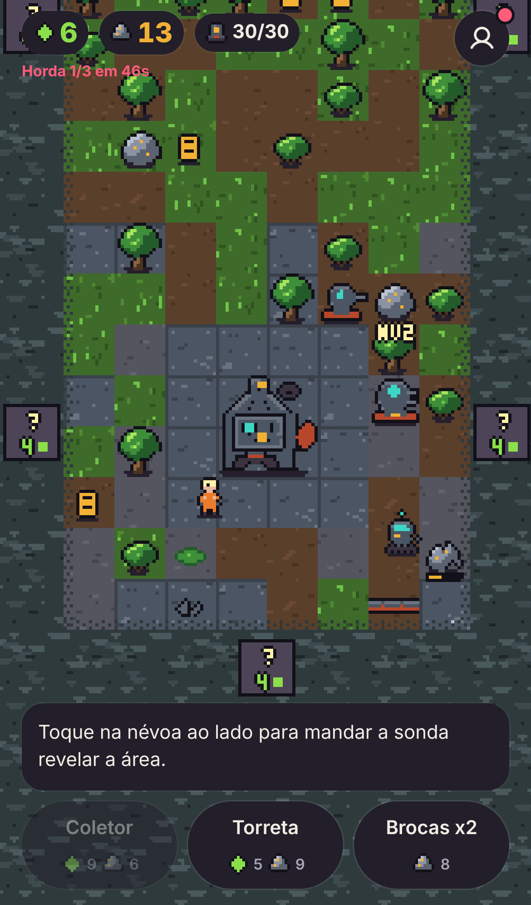         |
| Tremor: aviso antes da horda                             | 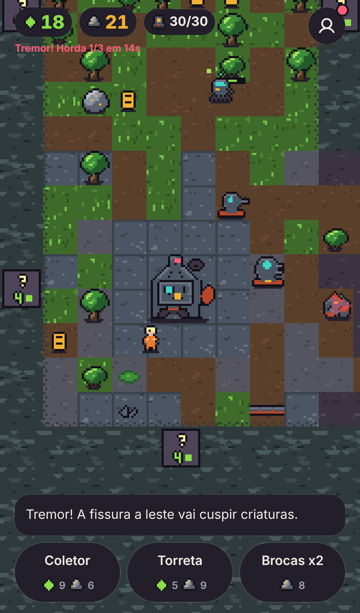                                      |
| Horda: larvas mordendo a torreta, fissura à direita      | 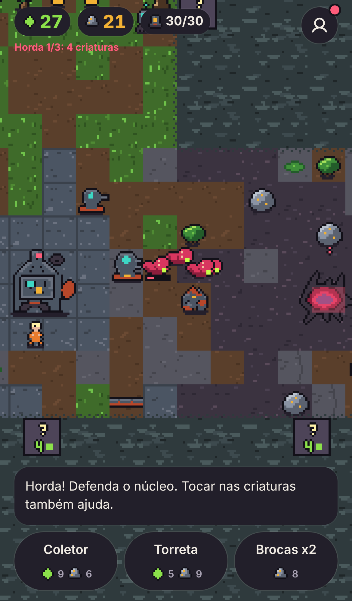 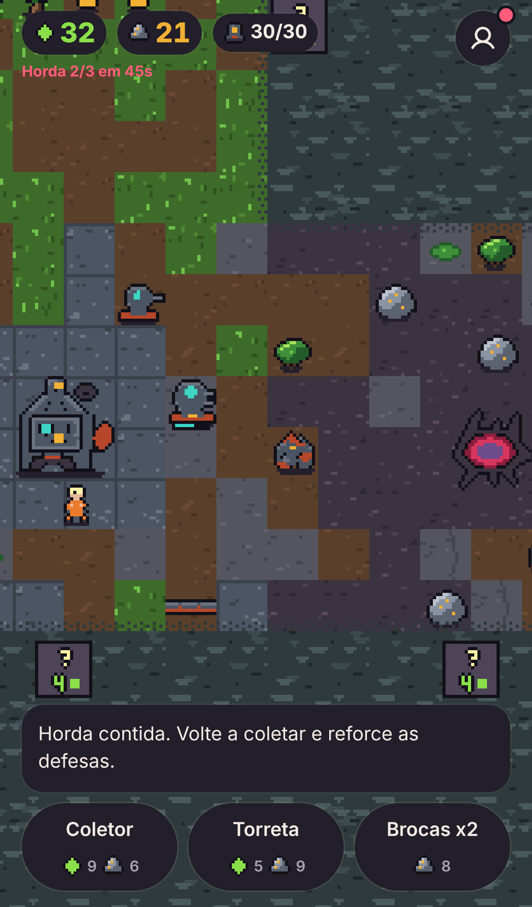               |
| Derrota / vitória                                        | 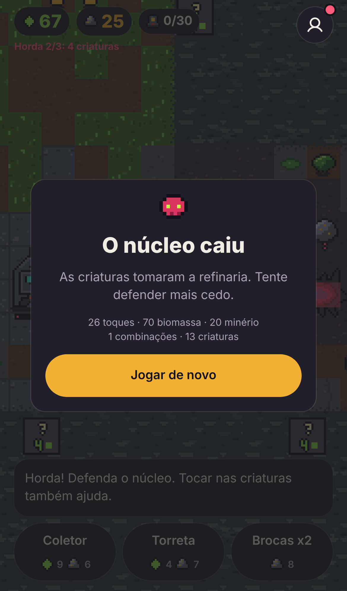 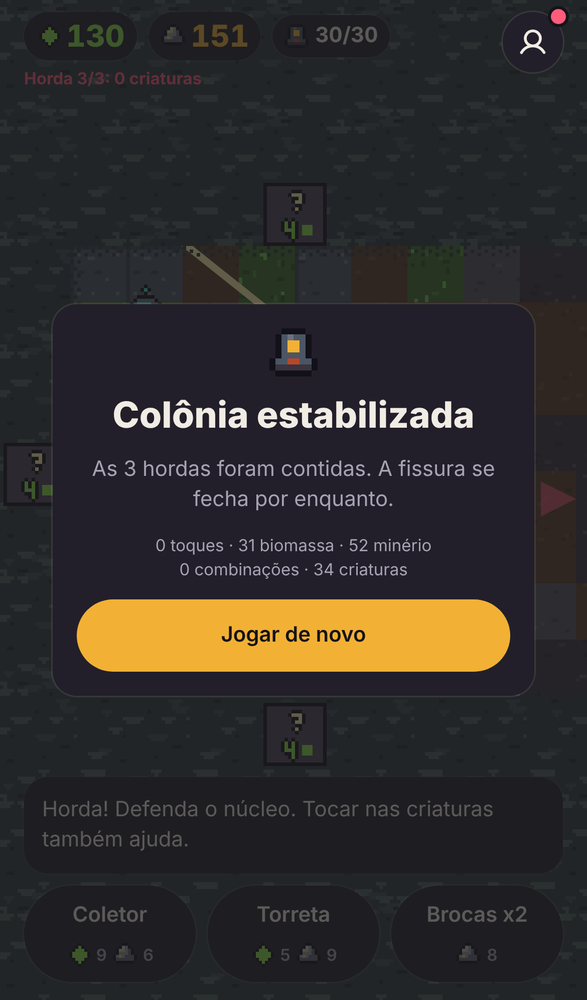                 |
| Desktop (mouse)                                          | 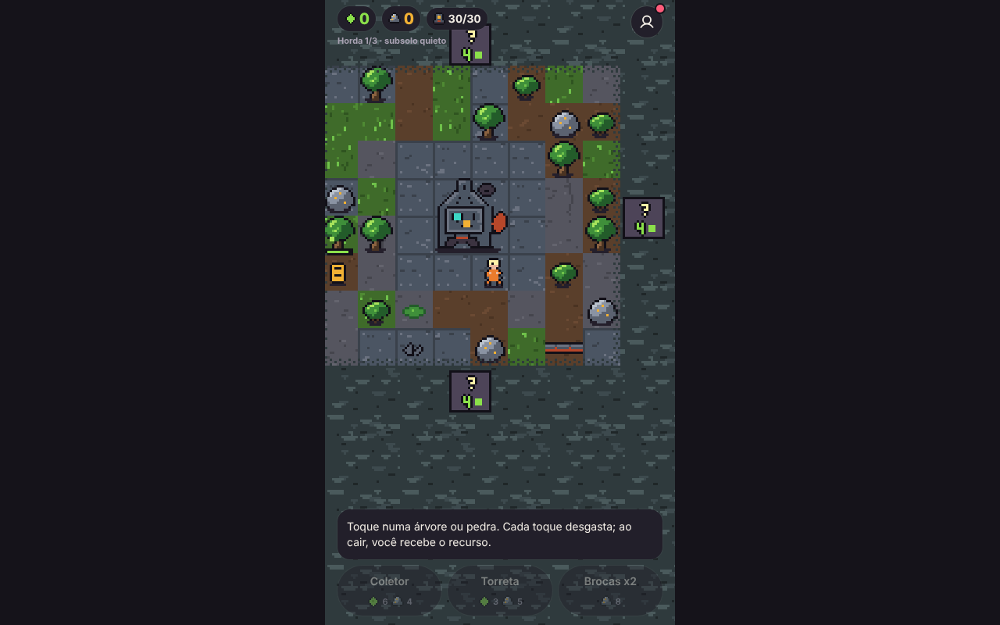                                     |

As capturas vieram de um roteiro Playwright que dispara toques e arrastos
reais na tela; o jogo expõe `window.__fissura` só com `?debug` na URL, para
esse tipo de script.

## Escolhas feitas só para viabilizar o teste

- **Perspectiva 3/4 (vista de cima com faces frontais), não isométrica.** Em
  tela de celular em pé, o losango isométrico desperdiça metade da largura e
  faz os alvos de toque serem rômbicos. A vista 3/4 mantém tiles quadrados
  (toque confiável), e a profundidade vem de sombras, faces frontais e da
  ordenação por `y` dos sprites.
- **Exploração por "placa na névoa".** Em vez de unidade exploradora
  controlável, cada região escondida vizinha de uma revelada mostra uma placa
  `?` com o custo. Tocar manda uma sonda (só visual) e revela a região inteira
  em 7 s. É explícito, cabe num toque, roda em paralelo ao ciclo principal e
  não exige visão dinâmica. Regiões reveladas ficam reveladas.
- **Mapa 24×24 em 9 regiões de 8×8.** A colônia central tem tudo para
  coleta + automação; a fissura fica na região leste e **se revela sozinha no
  primeiro tremor** mesmo sem explorar — a ameaça nunca depende de o jogador
  ter saído de casa.
- **Sem moeda de "pulso", sem tocar no núcleo.** O primeiro minuto é tocar no
  mundo → elemento cai → recurso. O núcleo é só o que se defende.
- **Uma melhoria só (Brocas).** Sobe a força do toque manual _e_ dos coletores
  de uma vez — mantém o toque relevante sem uma árvore de upgrades.
- **Merge só por toque (selecionar → tocar na igual).** Sem arrastar, para não
  brigar com o arrasto da câmera. Resultado fica na posição da segunda.
- **Hordas em bloco (0,4 s entre criaturas)**, não em fila: em fila, uma
  torreta nível 1 vence qualquer onda e o merge não faz diferença.
- **Inimigos andam em linha reta até o núcleo** e mordem o que estiver a
  0,8 tile (torretas e coletores têm vida). Sem pathfinding.
- **Rebrota lenta de arbustos** (1 a cada 8 s, teto 10) para o mapa não
  esvaziar; pedras são finitas, o que dá motivo para explorar.
- **HUD em DOM com o design system do template** (cards, botões), ícones de
  recurso vindos dos mesmos sprites. Texto dentro do canvas usa uma fonte de
  3×5 px desenhada à mão (`+4`, `NV2`, `?`).
- **Narrativa provisória:** colônia de humanos e robôs raspando a superfície de
  um mundo industrial morto; a mineração acordou o que dormia no subsolo. Uma
  linha no changelog e nada mais.
- **Condições de teste:** vencer = 3 hordas contidas; perder = núcleo a 0.
  Os números vivem em `src/core/game/balance.ts`, todos num lugar só.

## Avaliação

**A coleta manual é agradável?** Sim, com ressalva. O trio toque → tremor do
sprite + faísca → barrinha caindo → `+4` flutuando dá retorno claro, e a
árvore muda de desenho em 3 estágios. A ressalva: 8 a 10 toques por elemento
no começo é um pouco longo quando se está sem nada; vale testar 6/8 ou dar
2 de recurso em estágios intermediários.

**A automação chega no momento certo?** Chega em ~30 s de jogo (duas árvores
e uma pedra), antes do tédio do toque. O coletor aparece e vai sozinho para o
elemento mais próximo, o que é legível. O que falta sentir é _escala_: um
coletor nível 1 rende pouco; o segundo custa 50% mais. Para o teste, talvez
o primeiro já devesse vir com um segundo baratinho logo atrás.

**O merge faz diferença na defesa?** Faz, e o balanceamento foi puxado para
isso: duas torretas Nv.1 (2,5 de dano/s) perdem para a horda 2; uma Nv.2
(4,6/s, alcance maior, 24 de vida) segura. Na rodada automatizada das
capturas, 1 Nv.2 + 1 Nv.1 sem toques manuais contiveram a horda 1 e
perderam na 2 — a vitória precisa de mais merges ou de toque ativo. O risco
é o oposto: a horda 3 (14 larvas + 3 brutamontes) pode estar dura demais em
4 minutos; esse é o primeiro número a mexer depois de um teste com gente.

**A exploração com névoa gera curiosidade sem atrapalhar?** A placa `?` com
custo encostada na névoa é visível sem arrastar e o custo (4 biomassa) é
baixo, então dá para explorar entre uma compra e outra. A sonda voando e a
névoa dissolvendo dão a recompensa visual. O que atrapalha um pouco: a névoa
tramada ocupa muito da tela no começo (só 1 tile de névoa visível nas
laterais). Se a curiosidade não aparecer no teste, revelar uma faixa de
2 tiles além da colônia já no início ajudaria a "ver que tem mais".

**A navegação e a leitura do mapa funcionam no celular?** A colônia inteira
(8×8) cabe na largura de um iPhone com ~37 px por tile; elementos ocupam o
tile quase todo, então o toque acerta. Toque × arrasto não conflita (limiar
de 8 px). Leitura: terreno em tons de terra/concreto, recursos verde e cinza,
aliados teal/laranja, criaturas magenta — separam bem; a névoa é textura
tramada azul-esverdeada, diferente de sombra. Pontos fracos: o HUD de cima e
de baixo come ~35% da altura, e as torretas Nv.1 são pequenas; vale um
pinch-zoom e sprites de torreta mais largos na próxima rodada.

## Estrutura

```
src/core/game/   cérebro: tipos, balance.ts, map.ts (geração), game.ts (simulação) + testes
src/ui/game/     pele: palette.ts, sprites.ts (pixel art em texto), renderer.ts (canvas),
                 camera.ts, input.ts, GameCanvas.tsx (loop), GameHud.tsx, snapshot.ts
src/ui/screens/GameScreen.tsx   compõe canvas + HUD + menu do template
```
